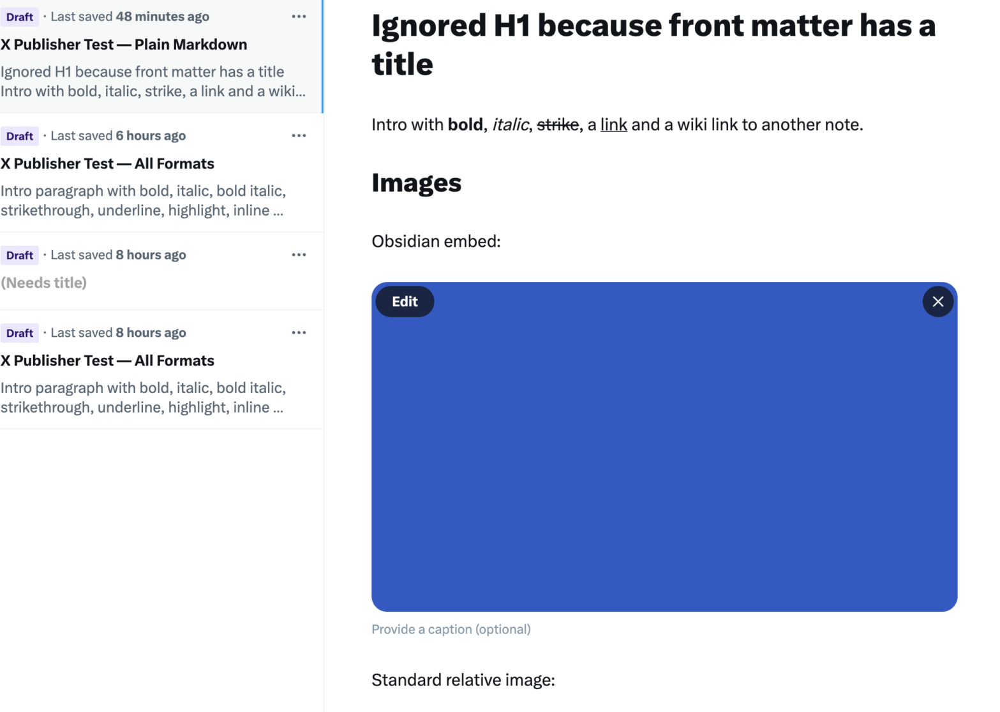
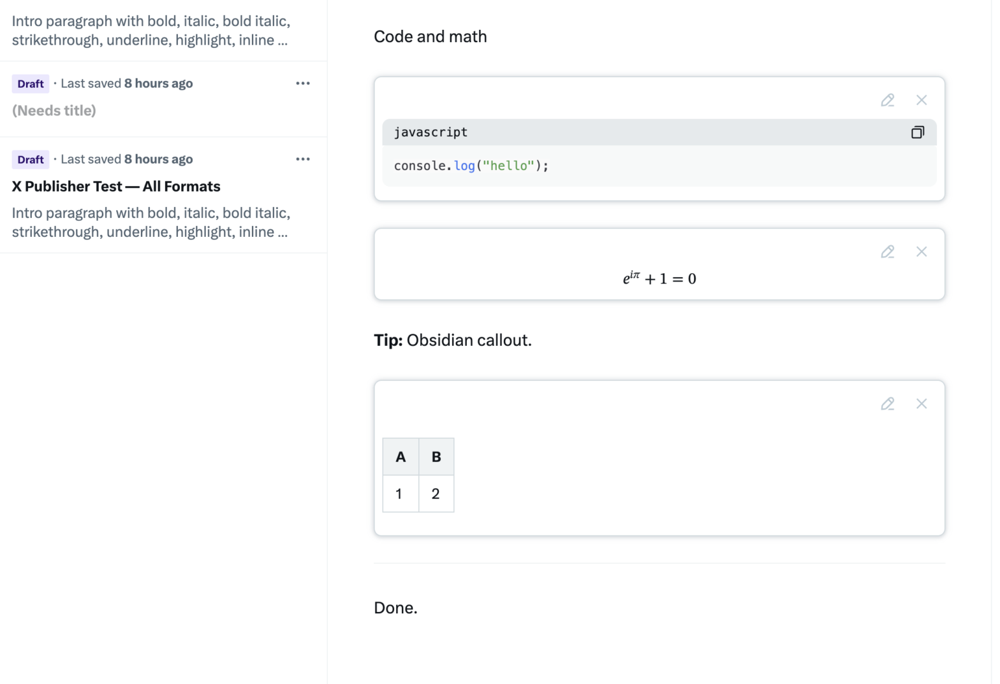

# Notetaker X Publisher

**Any article → a publish-ready X Article.**

Write where you like: SiYuan, Obsidian, Notion, Word, or any other note app. This tool turns your
article into an X Article draft that is ready to publish. It keeps the title, cover, headings, lists,
links, images, code, math, tables and embedded posts. It changes what X cannot show into the nearest
thing X can show, and it lists every change. Then you read the draft in X and click **Publish** yourself.

> "Make an X article draft from ~/Documents/Launch post.docx"
>
> → your agent previews it, makes a new X Article draft in your browser, and reports each format change.

- **Any format.** Markdown, Obsidian, Word (`.docx`, `.doc`, `.rtf`, `.odt`), HTML, Notion pages,
  SiYuan, pasted text, and any other note app.
- **Native X blocks.** Code blocks, LaTeX, tables, dividers and post embeds use X's own blocks.
  Images upload as media. Mermaid diagrams become images.
- **Checked.** After the editor is filled, the tool reads the draft back and reports any missing parts.
- **You publish.** The tool only makes drafts. It has no publish command or route, so it can never post
  for you.
- **Your browser.** It works in your logged-in Brave (or Chrome), in one background window. It does not
  need your X password or an X API key.

## Example

These drafts were made from one Obsidian note, [`test/vault/Markdown File Test.md`](test/vault/Markdown%20File%20Test.md).

**Text, links and an Obsidian image embed.** The front matter `title` became the article title.
`[[Other Note|another note]]` became plain text, and `![[blue diagram.png]]` was found in the vault
and uploaded.

```markdown
---
title: X Publisher Test — Plain Markdown
cover: cover.png
---

# Ignored H1 because front matter has a title

Intro with **bold**, *italic*, ~~strike~~, a [link](https://example.com) and a wiki link to [[Other Note|another note]].

## Images

Obsidian embed:

![[blue diagram.png]]
```



**Code, math, a callout and a table.** The code block, the LaTeX and the table use X's own blocks.
The Obsidian callout became a bold label, and `---` became an X divider.

````markdown
## Code and math

```js
console.log("hello");
```

$$
e^{i\pi} + 1 = 0
$$

> [!TIP]
> Obsidian callout.

| A | B |
|---|---|
| 1 | 2 |

---

Done.
````



## Use it with your agent

The agent skill is in [`skill/SKILL.md`](skill/SKILL.md). It tells the agent how to find your article,
read each format, preview it, make the draft, and fix problems. You do not need to learn the commands.

You need: macOS, Node 24 or later, Brave or Chrome logged in to an X Premium account.

1. Get the code:
   ```sh
   git clone https://github.com/yuchengzhang966/notetaker-x-publisher.git
   cd notetaker-x-publisher
   npm install
   ```
2. Give the skill to your agent. For Claude Code, link the folder (keep the link: the skill finds the
   code through it):
   ```sh
   ln -s "$PWD/skill" ~/.claude/skills/x-articles
   ```
   For another agent that reads `SKILL.md` skills, link `skill/` into its skills folder the same way,
   or tell it to read `skill/SKILL.md` in this folder.
3. Let the tool use your browser. Turn on remote debugging in Brave or Chrome (see "Browser" in
   [docs/REFERENCE.md](docs/REFERENCE.md#browser)), then run:
   ```sh
   npm run install-agents
   ```
   This starts the browser bridge and the local service now and at each login. Click **Allow** when the
   browser asks "allow debugging?" (one time).
4. Ask your agent, for example:
   - "Make an X article draft from ~/Notes/Launch.md"
   - "Turn this Notion page into an X article: https://www.notion.so/..."
   - "Preview how my Word file ~/Documents/Post.docx will look on X"
   - "Draft my SiYuan note 'Launch notes' on X"

The agent makes the draft and gives you its link. Read the draft in X and click **Publish** yourself.
The skill never publishes.

For Notion pages, the agent tells you the one-time set-up (a Notion connection token that you put in
`.env` yourself). To connect another note app, ask the agent to "connect <app> to the X publisher".

Manual commands, every format rule and the set-up details are in [docs/REFERENCE.md](docs/REFERENCE.md).
